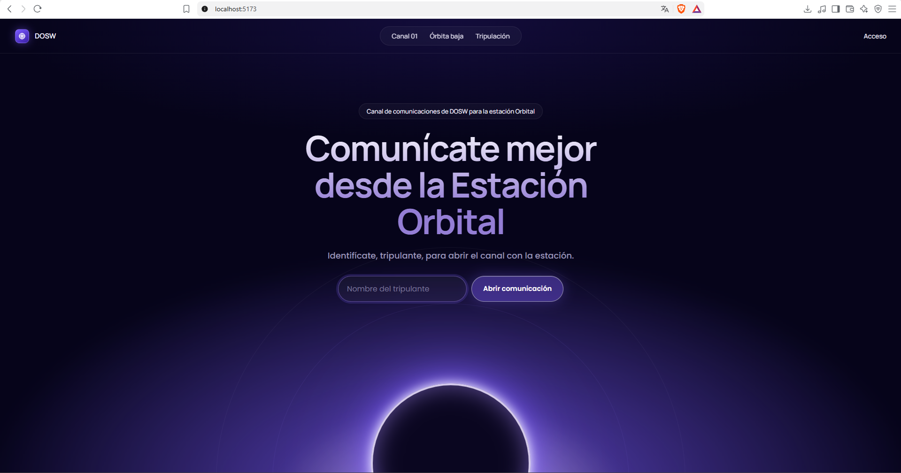
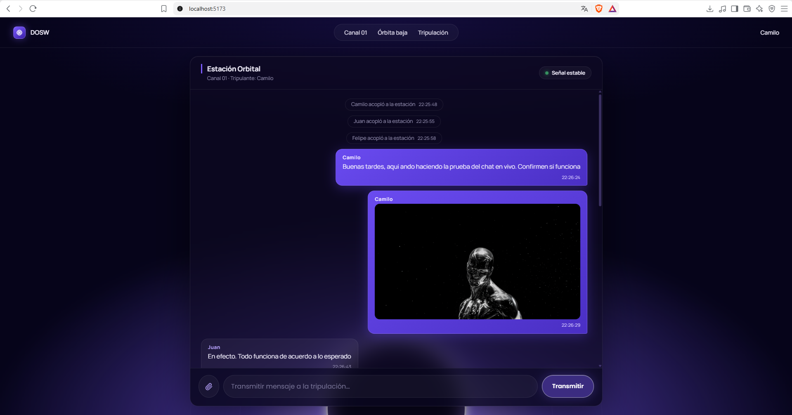
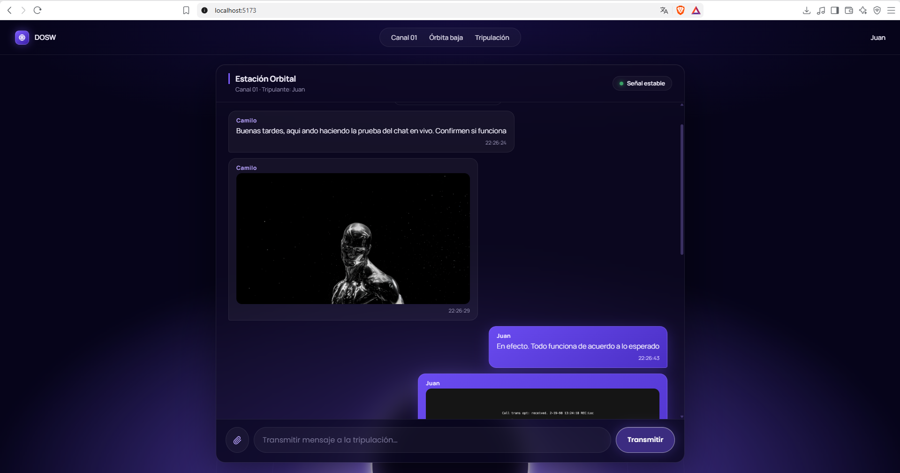
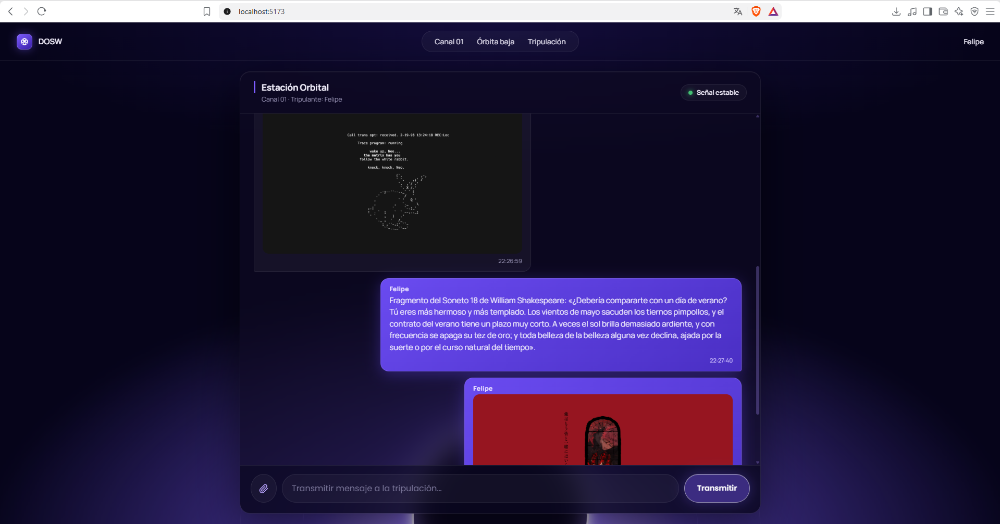
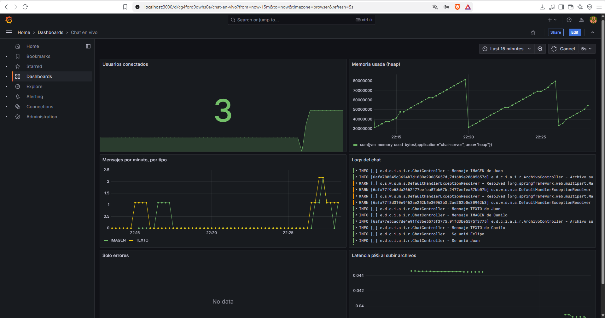
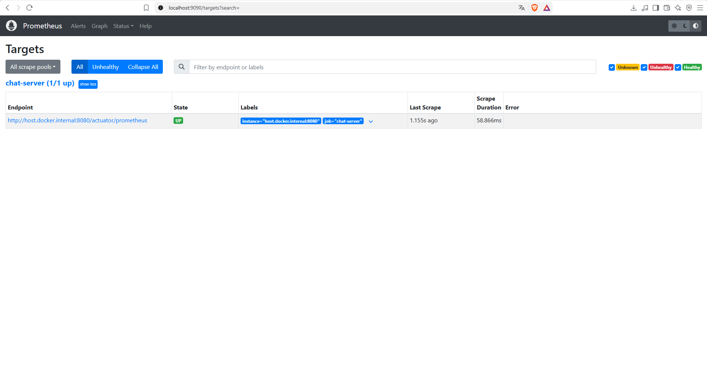
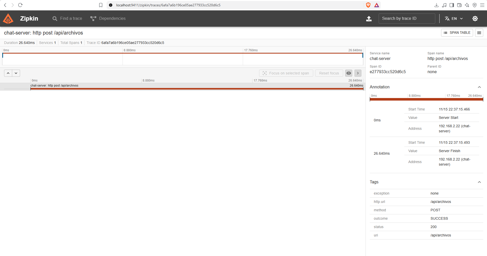

<div align="center">

  <h1>🛰️ Estación Orbital · chat-server</h1>

  <p align="center">
    <strong>Cristian Camilo Ortiz Sánchez</strong><br />
    DOSW 1 · Semana 15<br />
    Escuela Colombiana de Ingeniería Julio Garavito<br />
    cristian.ortiz-s@mail.escuelaing.edu.co
  </p>

  <p align="center">
    <strong>WebSockets y observabilidad</strong><br />
  </p>

</div>

---

## ¿Qué hace este servicio?

`chat-server` es el backend de **Estación Orbital**, un chat en vivo con temática espacial donde la tripulación se reporta desde la órbita. Está hecho con **Spring Boot 3.5.9 (Java 21)** y usa **WebSocket con STOMP**: la conexión se queda abierta y los mensajes llegan a todos los tripulantes sin que el navegador tenga que volver a preguntar.

Avisa a la sala cuando un tripulante **acopla** (entra) o se **desacopla** (sale) de la estación.
Cuenta con una función para compartir imagenes por a través del chat.
Expone **métricas**, **trazas** y **logs** para observar el servicio con Prometheus, Zipkin, Loki y Grafana.

**Cómo se conecta con el otro repo:** el cliente React ([`chat-client`](https://github.com/CatrachoINXS/chat-client)) abre el WebSocket en `ws://localhost:8080/ws`, se suscribe a la sala y publica mensajes. Los archivos se suben por `POST /api/archivos` y por el WebSocket solo viaja la URL.

```
Cliente ──publica──▶ /app/chat.enviar ──▶ ChatController ──▶ /topic/sala ──▶ todos los suscritos
```

## Tecnologías

- Java 21 · Maven · Spring Boot 3.5.9
- Spring Web · Spring WebSocket (STOMP)
- Spring Boot Actuator · Micrometer (Prometheus)
- Zipkin Reporter · Loki4j (Logback)
- Docker Compose · Prometheus · Loki · Zipkin · Grafana

### Cómo correrlo en local

#### Requisitos: Java 21, Maven y Docker Desktop para la observabilidad.

#### Pasos

```bash
# 1. Clonar el repositorio
git clone https://github.com/CatrachoINXS/chat-server.git
cd chat-server

# 2. Arrancar el servidor
mvn spring-boot:run
```

El servidor queda en `http://localhost:8080`. Para probarlo completo, levanta también `chat-client` y abre `http://localhost:5173` en varias pestañas con nombres distintos.

## Destinos STOMP

| Acción | Destino | Descripción |
|---|---|---|
| Handshake | `ws://localhost:8080/ws` | Responde `101 Switching Protocols` y deja la conexión abierta |
| **Enviar** | `/app/chat.unirse` | El tripulante anuncia que acopla a la estación |
| **Enviar** | `/app/chat.enviar` | Envía una transmisión (`TEXTO`, `IMAGEN`) |
| **Suscribirse** | `/topic/sala` | Recibe todas las transmisiones, acoples y desacoples |

Tipos: `TEXTO`, `IMAGEN`, `UNION`, `SALIDA`.

## API REST

| Método | Ruta | Descripción |
|---|---|---|
| `POST` | `/api/archivos` | Sube un archivo (campo `archivo`, máx. 5 MB) y devuelve `{ "url": "/api/archivos/<nombre>" }` |
| `GET` | `/api/archivos/{nombre}` | Muestra o descarga el archivo subido |

## Tema y funciones extra

**Tema escogido:** 🚀 **Estación espacial**: tripulación reportándose desde la órbita, modo oscuro, mensajes como transmisiones.



**Función extra implementada:** 🖼️ Imágenes - Subir una imagen y que todos la vean en el chat.



### Capturas




## Observabilidad

Toda la configuración está en la carpeta `observabilidad/`. Cubre: **métricas** (Prometheus), **trazas** (Zipkin) y **logs** (Loki), todo reunido en un tablero de Grafana.

### Levantar el stack

```bash
cd observabilidad
docker compose up -d
```

| Servicio | URL | Para qué sirve |
|---|---|---|
| Prometheus | http://localhost:9090 | Métricas (revisar `/targets`, estado **UP**) |
| Zipkin | http://localhost:9411 | Trazas |
| Loki | http://localhost:3100 | Logs (se consultan desde Grafana) |
| Grafana | http://localhost:3000 | Tablero (usuario `admin`, clave `admin`) |

### Tablero de Grafana

El tablero **Chat en vivo** está en `observabilidad/dashboard-chat.json` (para importarlo: Dashboards → New → Import).

### Capturas de observabilidad

> #### Tablero de Grafana
>
> 

> #### Prometheus Target
>
> 

> #### Traza Zipkin
>
> 

### Apagar al terminar

```bash
cd observabilidad
docker compose down
```